# 2. Kỹ năng prompting với AI
- Nghệ thuật đặt câu hỏi hiệu quả với AI
- Tối ưu hóa kết quả thông qua cách viết prompt chuyên nghiệp

- Prompt quan trọng vì AI không thực sự hiểu được suy nghĩ của con người. AI phản hồi dựa trên cách bạn hỏi => Prompt rõ ràng cho ra kết quả chính xác. Chất lượng câu trả lời phụ thuộc vào câu hỏi
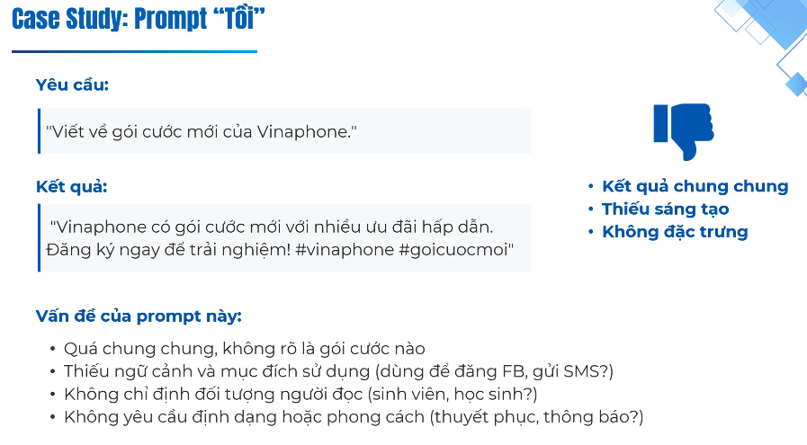

- Các nguyên tắc vàng:
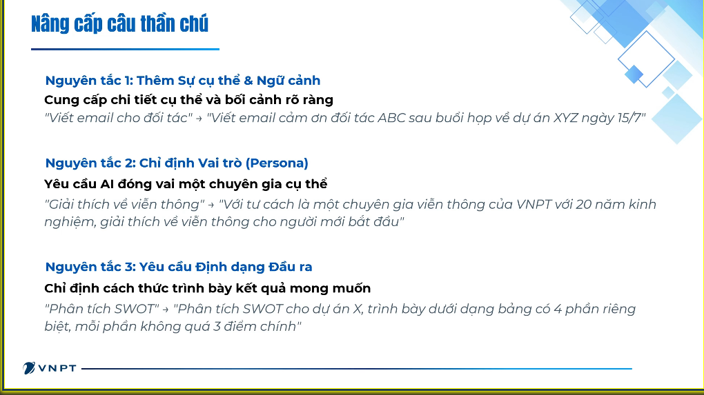

- Áp dụng
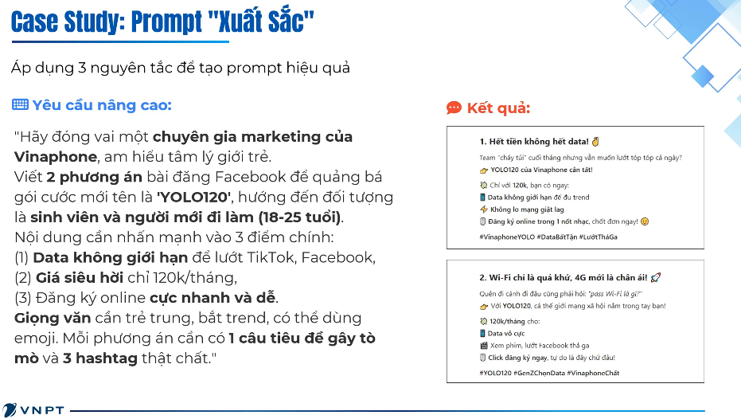

- Nâng cao: 1 prompt tốt không chỉ là viết đúng mà là giao tiếp hiệu quả với AI. Các kỹ thuật
    - Zero-short prompting (đang dùng hằng ngày, mô tả rõ ràng cụ thể. AI sẽ thực hiện mà không cần bất kỳ tham chiếu nào)
    
    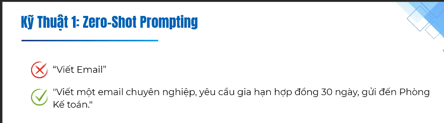
    
    - Few-short prompting (dạy AI 1 ví dụ do AI rất giỏi bắt trước)

    - Chain-of-thought-prompting: tư duy theo chuỗi. Đây là công cụ mạnh nhất để đảm bảo công cụ và chất lượng hiệu quả của AI
        - Nếu hỏi một vấn đề quá khó ngay từ đầu, AI có thể trả lời sai hoặc bịa đặt
        - Đây là một mệnh lệnh tư duy logic. Bảo nó suy nghĩ trước khi trả lời, giúp minh bạch quá trình xử lý. AI tự suy
    
        
        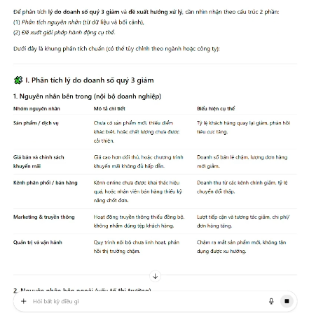
        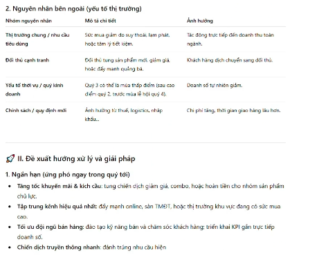
        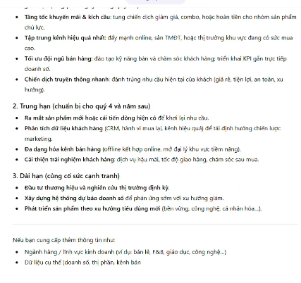

        - Trả lời rất chung chung và không sử dụng được khi không có COT
        - Nếu có COT
        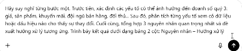
        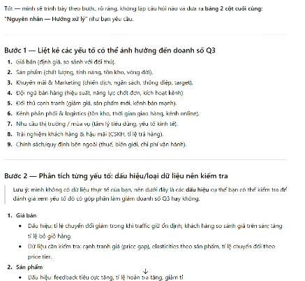
        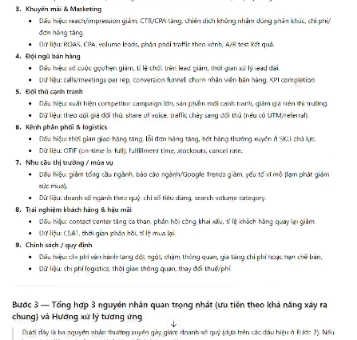
        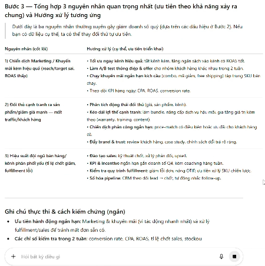
        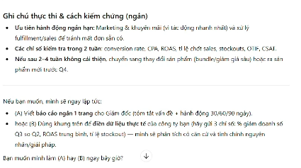

- Nâng cấp prompt bằng tương tác: kỹ năng prompt tốt không phải là viết 1 lần prompt hoàn hảo mà là tương tác sau khi trả lời.
    - Hãy tóm tắt lại trong 50 câu
    - Điều chỉnh giọng văn vui vẻ hài hước
    - Áp dụng kỹ thuật COT

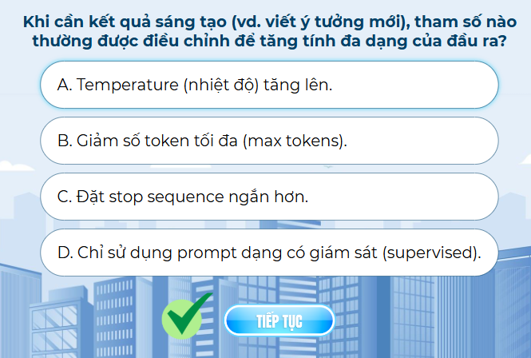

# 3. Các công cụ AI
- Viết lách
    - gemini
    - chatgpt
- Tạo hình ảnh độc đáo đúng ý tưởng
    - Midjourney
    - DALL-E
- Tóm tắt các ghi chú dài thành các luận điểm chính
    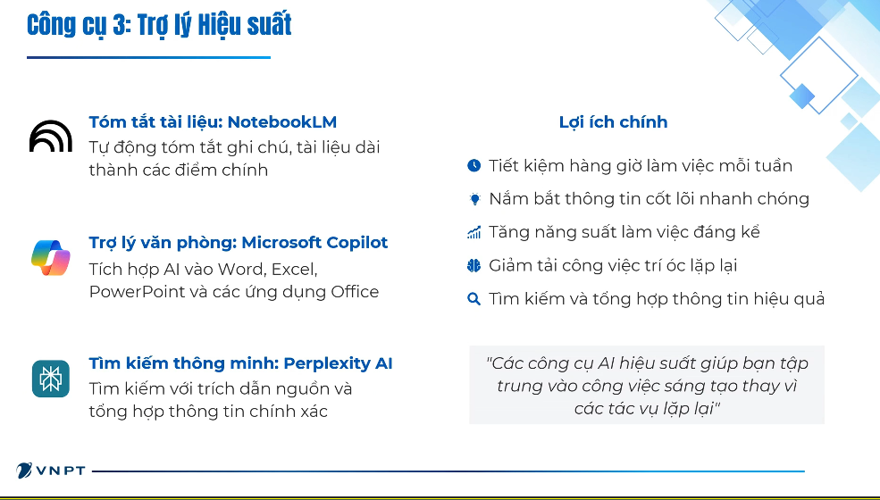

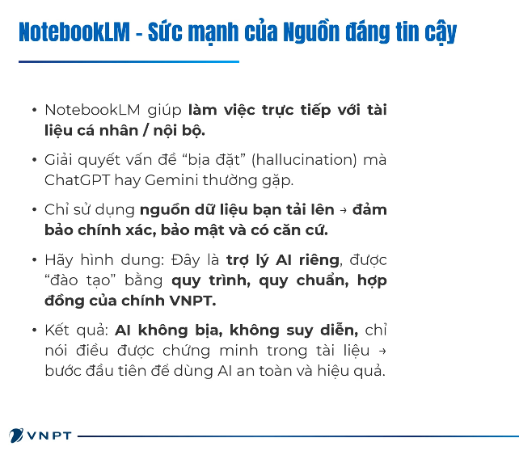

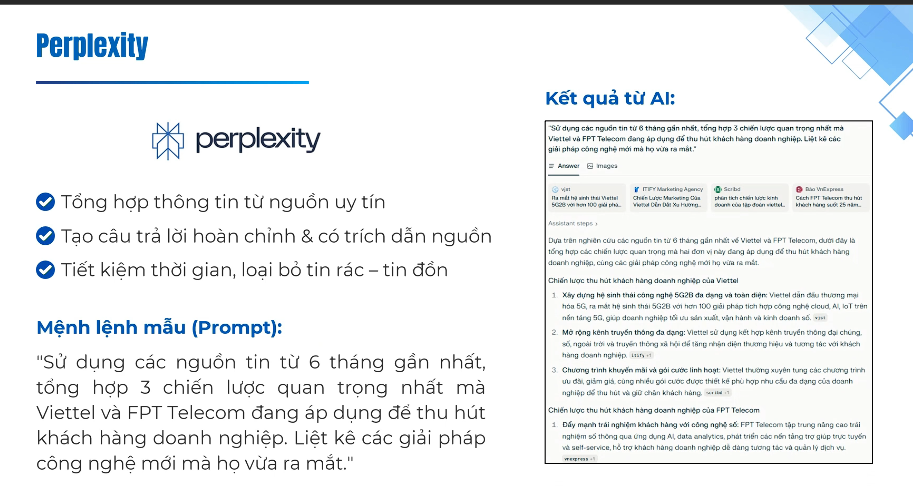

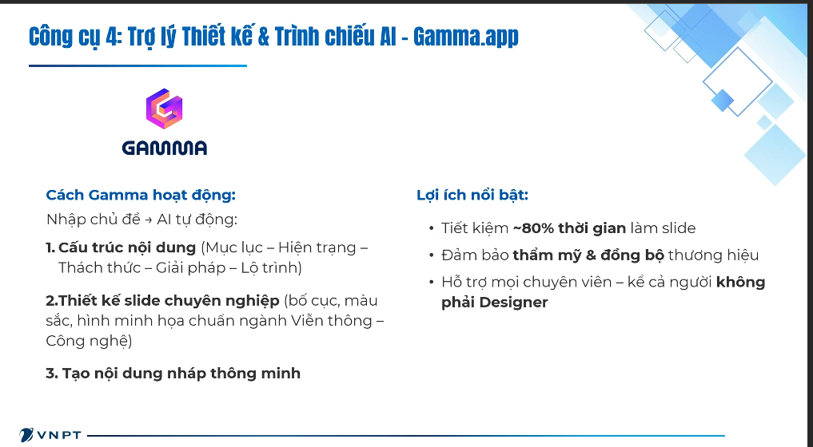